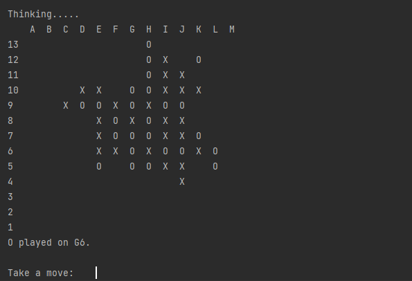
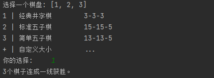

> ### This is a mirror repository, read-only.
> 
> **To contribute**, please visit the [upstream repo](https://codeberg.org/distantbytes/Tic-tac-terminal/) on _Codeberg_.

<div align="center">

 
[](https://codeberg.org/distantbytes/Tic-tac-terminal)

[](https://codeberg.org/distantbytes/Tic-tac-terminal/src/branch/main/LICENSE)

</div>

# Tic-Tac-Terminal

Terminal MNK games written in *Kotlin*, with GOFAI opponent. The bot is designed to be beatable, of course.

No fancy math here, just a surprisingly straightforward algorithm. The idea is simple: loop through every square on each line, in all directions, and analyze the patterns.

The algorithm as been improved **significantly**! Now the bot is much smarter, it doesn't just block your lines, but builds its own as well.


___
### How to play
Download the jar from [releases](https://codeberg.org/distantbytes/Tic-tac-terminal/releases), then use this terminal command:
```shell
java -jar Tic-tac-terminal-<verison>.jar
```
Add an argument (`1` `2` or `3`) to specify the board.

For example:
```shell
java -jar Tic-tac-terminal-<version>.jar 2
```

(Replace `<version>` with actual version number)



### Requirements
- _JDK 11_
___
### Issues
If you encounter any problems, go to [issues page](https://codeberg.org/distantbytes/Tic-tac-terminal/issues) 