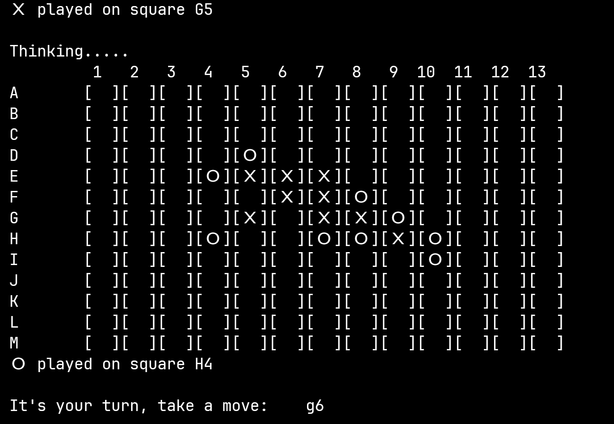
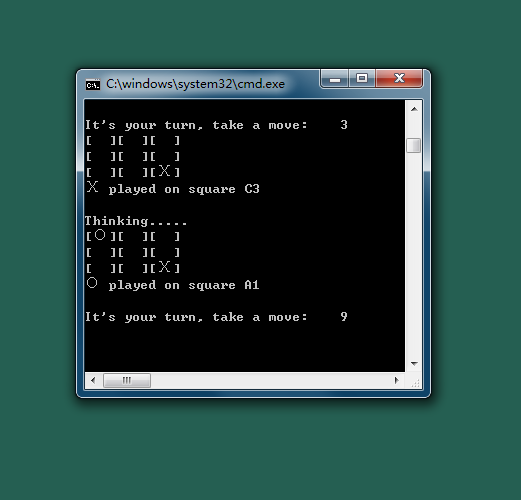
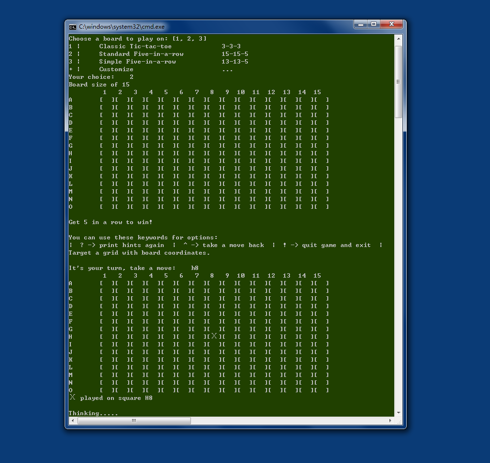
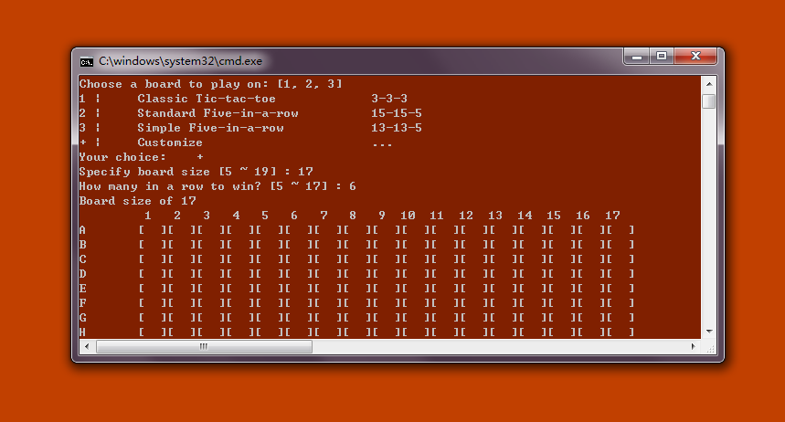

# Tic-Tac-Terminal

Terminal MNK games written in *Kotlin*, with GOFAI opponent that loops through and analyzes every square on each line, all directions. The bot is designed to be beatable, of course.

Forget about all the maths stuff, here the most brute-force algorithm you'll ever see in a chess program is used, the idea was simple but actually quite difficult to code.

Lately, we improved the algorithm __significantly__! Now the bot is much smarter, and takes the initiative to attack.
>
___
### How to run
>

Download the jar from releases, then use this terminal command:
```
java -jar Tic-tac-terminal-ver*.jar
```
Replace `ver*` with actual tag version.
___
### Dependencies
- JDK 11
___
### New features
Since `v1.2`, you can execute an operation by entering keywords:
| Keyword | What does it do | Since |
| :---: | :---: | :---: |
| `!` | Quit | v1.2-rc |
| `?` | List tokens and keywords | v1.2-rc |
| `^` | Take a move back | v1.3-rc |

>
### "K < M,N"

Five-in-a-row and other variants are supported since `v1.4-rc`. You can choose from several templates.

Or, you can customize board size in the latest version.

>
___

If some of the texts aren't rendered properly, try another font or terminal app. Should work.
Have other problems? [Go to issues page](https://codeberg.org/Distantbytes/Tic-tac-terminal/issues)